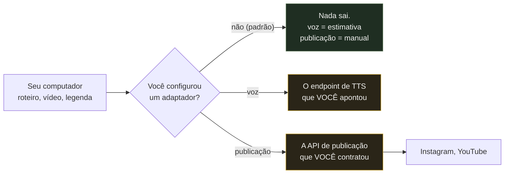

# Política de privacidade — Motor de Canal

Última revisão: 20/11/2026.

## Resumo em uma tabela

| Pergunta | Resposta |
| --- | --- |
| O plugin coleta dado pessoal? | **Não.** Nome, e-mail, endereço: nenhum |
| Tem servidor do outro lado? | **Não.** Não existe serviço nosso |
| Guarda alguma coisa? | **Não.** Nada sai do seu computador por nossa conta |
| Tem analytics ou telemetria? | **Não** |
| Manda algo para terceiro? | **Só se você configurar.** Tabela abaixo |

O plugin é texto: nove skills e quatro comandos em Markdown. Ele não executa
nada sozinho e não fala com servidor nenhum.

## O que pode sair da sua máquina, e por sua conta

| Adaptador | Padrão | O que vai, se você trocar o padrão | Para onde |
| --- | --- | --- | --- |
| voz | `estimativa`, roda local, não usa rede | o texto das falas do vídeo | o endpoint de TTS do seu `.env` |
| publicação | `manual`, só prepara a pasta | vídeo, capa e legenda | a API de publicação que você contratou |

Nos dois casos a chave é sua, o destino é escolhido por você e o dado vai
direto do seu computador para lá. **Não passa por nós, porque não existe um
"nós" no caminho.** O que esses terceiros fazem com o dado é a política deles,
não a nossa: leia a política do serviço de TTS e a da API de publicação que
você escolher.

## Chaves

Ficam no `.env` do seu canal, que o `.gitignore` do modelo já exclui do
versionamento. O plugin não traz chave nenhuma e não lê chave de outro lugar.

## Dados de quem assiste

O plugin não recebe nada de espectador. Métrica de alcance e visualização,
quando você usa a ferramenta de análise, vem da API da plataforma para o seu
computador, e fica lá.

## Contato

Abra uma issue: <https://github.com/claudiogpt/motor-de-canal/issues>
