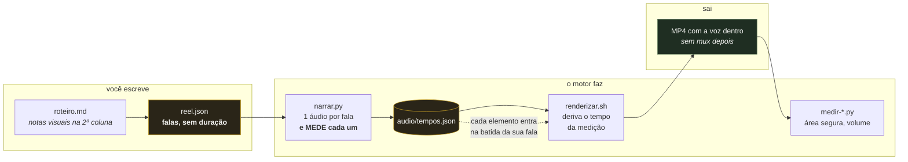
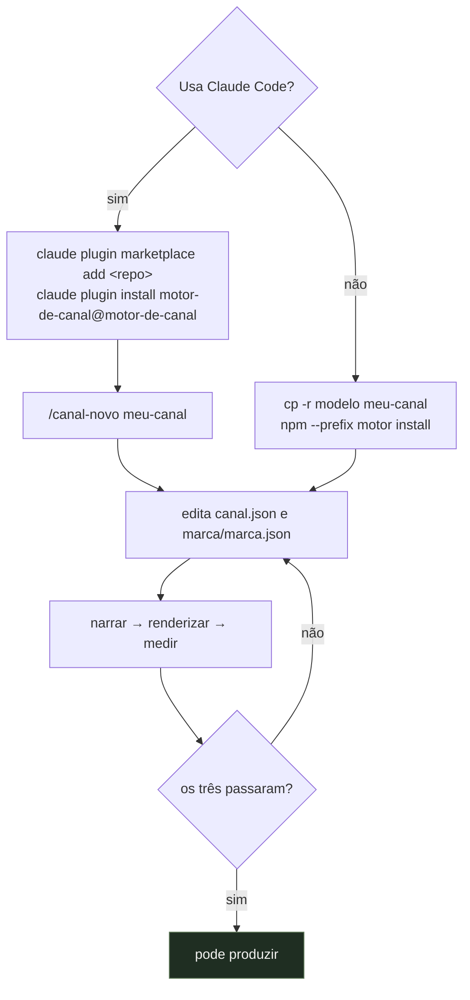

# Motor de Canal

Framework para gerar e operar canais de vídeo curto no YouTube e no Instagram.

Não é teoria. Saiu de um canal em produção (18 vídeos, 4 formatos, 3.085 views
no primeiro mês), e **cada regra aqui existe porque algo deu errado antes**.

## O sistema inteiro, de uma vez



**O áudio manda no tempo.** O JSON não declara duração nenhuma: declara
**falas**. Não existe passo de mux depois do render, então não existe como a
voz e a tela saírem de sincronia — não há dois relógios para divergir, há um.

## Os quatro formatos

| | Tamanho | Para onde | Comando |
| --- | --- | --- | --- |
| 📱 Reel / Short | 1080×1920 | Instagram + YouTube | `./renderizar.sh` |
| 🖥 Vídeo longo | 1920×1080 | YouTube | `./renderizar.sh` |
| 🖼 Carrossel | 1080×1350 | Instagram | `./renderizar-carrossel.sh` |
| 🎭 História animada | os dois | personagens por código | `./renderizar.sh` |

## Começar



```bash
cp -r modelo meu-canal && cd meu-canal
npm --prefix motor install
python3 -I ferramentas/narrar.py conteudo/exemplo-tres-alugueis
./renderizar.sh conteudo/exemplo-tres-alugueis
python3 -I ferramentas/medir-reel.py conteudo/exemplo-tres-alugueis/out/reel.mp4
```

**Roda sem chave, sem GPU e sem custo.** O adaptador de voz padrão
(`estimativa`) gera silêncio do tamanho exato que a fala teria, então você
monta, renderiza, mede e revisa o vídeo inteiro de graça. Só a publicação
exige voz de verdade.

## Precisa ter

| | Para quê | Obrigatório |
| --- | --- | --- |
| `ffmpeg` + `python3` | medir, narrar, converter | **sim** |
| `node` 20+ | Remotion | **sim** |
| conta Modal | voz de verdade | não |
| conta de agendamento | publicar por API | não |

Python usa **só a biblioteca padrão**. Nada de `pip install`.

## Documentação

| Para | Leia |
| --- | --- |
| Entender como funciona | [01 — Como funciona](docs/01-como-funciona.md) |
| Criar o seu canal | [02 — Criar um canal](docs/02-criar-um-canal.md) |
| Produzir uma semana | [03 — Produção semanal](docs/03-producao-semanal.md) |
| Histórias com personagens | [04 — Histórias animadas](docs/04-historias-animadas.md) |
| O que aprendemos errando | [05 — Lições aprendidas](docs/05-licoes-aprendidas.md) |
| Publicar o plugin | [06 — Diretório da Anthropic](docs/06-publicar-no-diretorio.md) |

A doutrina que a IA segue está em [skills/](skills/). Vale a leitura mesmo para
quem não usa IA: é o manual do canal.

## Licença

MIT. O [motion-kit](https://github.com/Gaok1/motion-kit), usado nas histórias
animadas e fixado no commit `459b0ee`, também é MIT.
