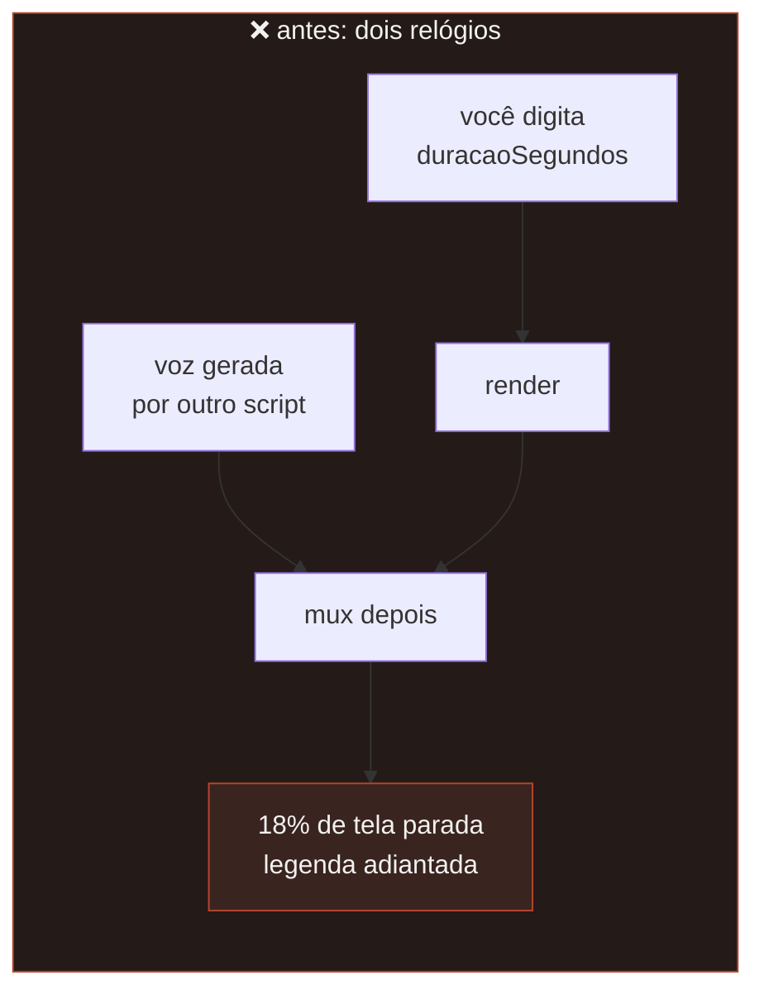
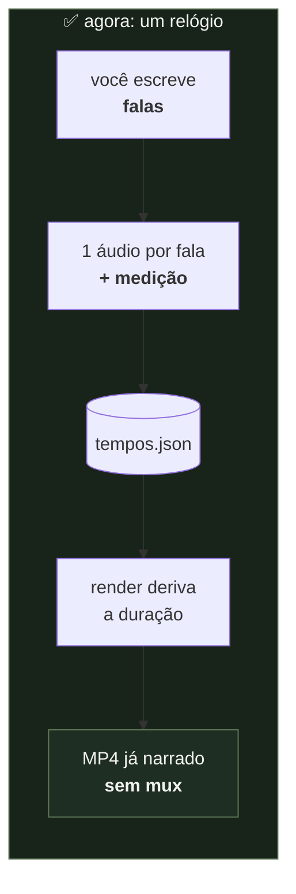
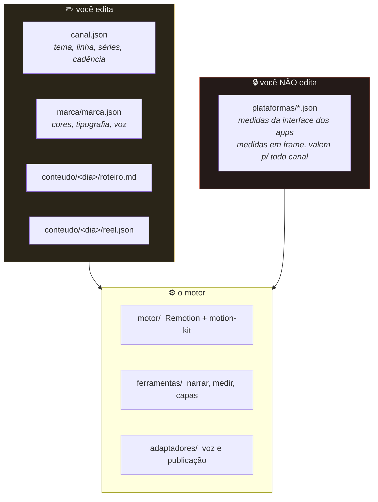
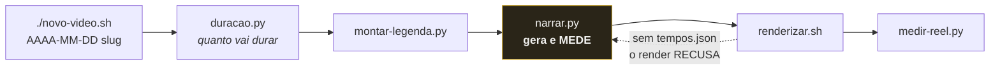

# Como funciona

Para quem vai usar, não para quem vai mexer no código.

## Os três trabalhos chatos, e como o motor mata cada um

| O trabalho que se repete | Feito à mão dá | O motor faz |
| --- | --- | --- |
| Encaixar a imagem no tempo da voz | desencaixa | **o áudio mede, o vídeo obedece** |
| Conferir que nada ficou fora da tela | passa batido | **medidor por faixa, falha sozinho** |
| Não deixar número da tela divergir da conta | diverge | **recalculado por script antes do render** |

---

## 1. O áudio manda no tempo

### O defeito que isto corrige





### Como você escreve

```json
{
  "tipo": "escada",
  "degraus": [
    { "horas": "44", "quando": "antes", "naBatida": 0 },
    { "horas": "42", "quando": "agora", "naBatida": 1 }
  ],
  "falas": [
    "Hoje são quarenta e quatro horas.",
    "Em dezembro caem para quarenta e duas."
  ]
}
```

`naBatida: 1` = **este elemento entra quando a segunda fala começar.**

```
             0s        1s        2s        3s        4s        5s        6s   7s
             ├─────────┼─────────┼─────────┼─────────┼─────────┼─────────┼────┤
                       batida 0                      batida 1
                          ▼                             ▼
  🔊 voz      ████████████████████████████  ██████████████████████████████████
              "Hoje são quarenta e quatro   "Em dezembro caem para quarenta
               horas."                       e duas."

  🖥 tela     ┌──────────────────────────────────────────────────────────────┐
   naBatida 0 │  44  antes                                                   │
   naBatida 1 │                              42  agora ──────────────────────│
              └──────────────────────────────────────────────────────────────┘
                                            ↑
                        o degrau 42 ENTRA no frame em que a voz
                        começa a dizer "Em dezembro", não 7 frames
                        depois nem 0,8 s depois
```

Mudou a fala? O gráfico acompanha sozinho no próximo render. **Você nunca
reajusta um número de tempo.**

---

## 2. Mediu, não olhou

Todos os defeitos de layout deste framework foram achados por medição. **Vários
tinham passado por revisão humana antes.**

### A armadilha das duas réguas

Os ícones do Instagram ocupam a faixa direita **só no terço de baixo**:

```
        0                                   860   934  1080
        ├────────────────────────────────────┼─────┼────┤
  150   ┌─────────────────────────────────────────┐     │   ← topo da área segura
        │                                         │     │
        │          conteúdo pode ir até           │     │   limite: x=934
        │                                  x=934 →│     │
 1280   ├─────────────────────────────┐···········┤     │   ← AQUI A RÉGUA MUDA
        │   limite cai para x=860     │  ícones   │     │   curtir, comentar,
        │                      x=860 →│  do app   │     │   compartilhar, áudio
 1480   └─────────────────────────────┴───────────┘     │   ← legenda do app
        │              faixa da legenda                 │
 1920   └──────────────────────────────────────────────-┘
```

**Três vezes** um elemento cresceu em altura (nome longo, texto quebrando em
duas linhas) e a base entrou na faixa estreita. Ninguém viu a olho. O medidor
viu.

```bash
python3 -I ferramentas/medir-reel.py conteudo/<dia>/out/reel.mp4
```

| O medidor pega | O medidor NÃO pega |
| --- | --- |
| estouro de margem, por faixa | texto vazando de um cartão no meio da tela |
| tamanho e fps errados | a fala dizer uma coisa e a tela outra |
| volume fora de −14 LUFS | fato errado com margem certa |
| silêncio acima de 0,5 s | — |

---

## 3. Número se recalcula, não se digita duas vezes

Se o vídeo mostra "62% é seu", esse 62% é **calculado por script** a partir dos
valores, antes do render. Quando o número está em dois lugares, um dia eles
divergem — e o vídeo vai ao ar com a conta errada.

---

## O mapa dos arquivos



---

## Os comandos, na ordem



O `renderizar.sh` descobre o formato pelo arquivo que existe na pasta
(`reel.json`, `longo.json`, `historia.json`) e desvia para o
`renderizar-carrossel.sh` quando acha `carrossel.json`.

---

## Voz: três opções

| Adaptador | Custo | Precisa de | Quando |
| --- | --- | --- | --- |
| **`estimativa`** | **zero** | nada | **padrão.** Silêncio do tamanho certo. Montar e revisar. |
| `kokoro` | centavos | `MODAL_TTS_URL` | produção. Voz de modelo, roda em CPU. |
| `chatterbox` | centavos | URL + gravação sua | a sua voz clonada. |

Trocar é **uma linha** no `canal.json`.
