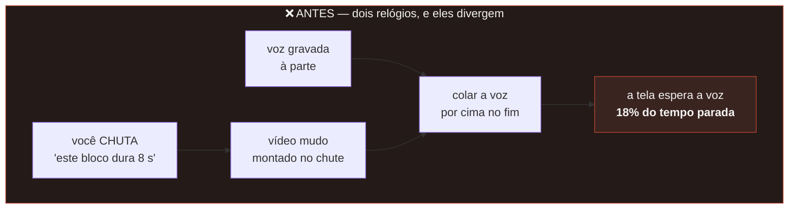
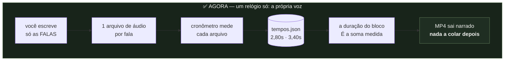
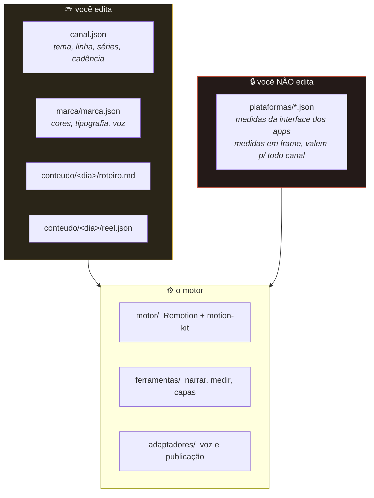
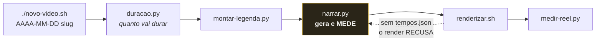

# Como funciona

Para quem vai usar, não para quem vai mexer no código.

## Os três trabalhos chatos, e como o motor mata cada um

| O trabalho que se repete | Feito à mão dá | O motor faz |
| --- | --- | --- |
| Encaixar a imagem no tempo da voz | desencaixa | **o áudio mede, o vídeo obedece** |
| Conferir que nada ficou fora da tela | passa batido | **medidor por faixa, falha sozinho** |
| Não deixar número da tela divergir da conta | diverge | **recalculado por script antes do render** |

---

## 1. O áudio manda no tempo

### Primeiro, as três palavras que você precisa

| Palavra | O que é, sem jargão |
| --- | --- |
| **fala** | uma frase que o narrador diz. Você escreve; o computador lê em voz alta. |
| **batida** | o **instante** em que uma fala começa. É a unidade de tempo do sistema: não é segundo, não é frame, é "quando a voz começa a dizer tal frase". |
| **colar a voz depois** | gerar o vídeo mudo, gerar a voz separada, e juntar os dois no fim. É o jeito comum de fazer — e é exatamente o que este sistema **não** faz. *(no jargão: "mux")* |

---

### O problema, com número

O jeito comum é: você **chuta** quanto cada parte do vídeo dura, monta o vídeo
mudo com esses chutes, grava a voz, e cola a voz por cima no fim.

O chute nunca bate com a voz real. Medido em nove vídeos de uma semana:

```
     tempo que a tela ficou parada esperando a voz terminar
     ███████████████████ 76,6 segundos  =  18% da semana inteira
     e no pior vídeo:  30%
```

E a legenda ficava sempre adiantada, porque ela seguia o chute e a voz seguia
a si mesma.

**Dois relógios. Eles nunca se encontram.**

---

### A inversão: ninguém chuta, o computador mede

Você escreve **só as falas**. Nenhum número de tempo.

```json
"falas": [
  "Hoje são quarenta e quatro horas.",
  "Em dezembro caem para quarenta e duas."
]
```

Aí o `narrar.py` faz **um arquivo de áudio para cada fala** — não um só para o
bloco inteiro — e **mede cada arquivo com um cronômetro**:

```
  VOCÊ ESCREVE                      O MOTOR GERA           E MEDE
  ─────────────────────────────────────────────────────────────────
  falas[0] "Hoje são 44 horas."  →  audio/b01-00.wav   →   2,80 s
  falas[1] "Em dezembro caem…"   →  audio/b01-01.wav   →   3,40 s
```

**Por que um arquivo por fala, e não um por bloco?** Porque é a única forma de
saber **em que segundo cada frase começa**. Com um áudio só, você sabe que o
bloco dura 6,6 s, mas não sabe quando a segunda frase entra — e é exatamente
isso que o gráfico precisa saber.

---

### "O render deriva a duração" quer dizer esta conta

O motor soma os pedaços medidos, e o resultado **é** a duração do bloco:

```
   2,80 s   +   0,12 s   +   3,40 s   +   0,30 s   =   6,62 s
   └ fala 0 ┘   └respiro┘   └ fala 1 ┘   └respiro┘      └ duração do bloco ┘
                 entre                    no fim
                 falas                    do bloco
```

Ninguém digitou 6,62. **Ele saiu da medição.** Se você trocar uma palavra na
fala, o áudio muda de tamanho, e 6,62 vira outro número sozinho, no próximo
render.

---

### E é daí que sai o `naBatida`

O motor agora sabe que a fala 0 começa em **0,00 s** e a fala 1 em **2,92 s**.
Então `naBatida` vira posição real na tela:

```
             0s        1s        2s        3s        4s        5s        6s
             ├─────────┼─────────┼─────────┼─────────┼─────────┼─────────┼──
                                           ▲
                                      2,92 s
  🔊 voz     ▓▓▓▓▓▓▓▓▓▓▓▓▓▓▓▓▓▓▓▓▓▓▓▓▓▓▓░░░▓▓▓▓▓▓▓▓▓▓▓▓▓▓▓▓▓▓▓▓▓▓▓▓▓▓▓▓▓▓▓▓
             "Hoje são quarenta e         "Em dezembro caem para
              quatro horas."               quarenta e duas."

  🖥 tela    ┌──────────────────────────────────────────────────────────────
  naBatida 0 │  44  antes
  naBatida 1 │                             42  agora
             └──────────────────────────────────────────────────────────────
                                           ↑
                            o "42" aparece no frame EXATO em que a voz
                            começa a dizer "Em dezembro" — não 7 frames
                            depois, não 0,8 s depois
```

E como o áudio de cada fala já é posto na linha de tempo nesse mesmo instante,
**o MP4 sai da máquina já narrado**. Não existe o passo de colar a voz depois.

---

### Antes e depois, lado a lado





**Por que isso elimina o erro em vez de reduzir:** não existem mais dois
números para comparar. A tela não tem duração própria — ela só lê a do áudio.
Dois relógios podem divergir; um relógio não tem com o que divergir.

> Por isso o `renderizar.sh` **recusa rodar** se o `tempos.json` não existir.
> Sem medição ele teria que chutar, e chutar é o defeito que o sistema existe
> para não ter.

---

## 2. Mediu, não olhou

Todos os defeitos de layout deste framework foram achados por medição. **Vários
tinham passado por revisão humana antes.**

### A armadilha das duas réguas

Os ícones do Instagram ocupam a faixa direita **só no terço de baixo**:

```
        0                                   860   934  1080
        ├────────────────────────────────────┼─────┼────┤
  150   ┌─────────────────────────────────────────┐     │   ← topo da área segura
        │                                         │     │
        │          conteúdo pode ir até           │     │   limite: x=934
        │                                  x=934 →│     │
 1280   ├─────────────────────────────┐···········┤     │   ← AQUI A RÉGUA MUDA
        │   limite cai para x=860     │  ícones   │     │   curtir, comentar,
        │                      x=860 →│  do app   │     │   compartilhar, áudio
 1480   └─────────────────────────────┴───────────┘     │   ← legenda do app
        │              faixa da legenda                 │
 1920   └──────────────────────────────────────────────-┘
```

**Três vezes** um elemento cresceu em altura (nome longo, texto quebrando em
duas linhas) e a base entrou na faixa estreita. Ninguém viu a olho. O medidor
viu.

```bash
python3 -I ferramentas/medir-reel.py conteudo/<dia>/out/reel.mp4
```

| O medidor pega | O medidor NÃO pega |
| --- | --- |
| estouro de margem, por faixa | texto vazando de um cartão no meio da tela |
| tamanho e fps errados | a fala dizer uma coisa e a tela outra |
| volume fora de −14 LUFS | fato errado com margem certa |
| silêncio acima de 0,5 s | — |

---

## 3. Número se recalcula, não se digita duas vezes

Se o vídeo mostra "62% é seu", esse 62% é **calculado por script** a partir dos
valores, antes do render. Quando o número está em dois lugares, um dia eles
divergem — e o vídeo vai ao ar com a conta errada.

---

## O mapa dos arquivos



---

## Os comandos, na ordem



O `renderizar.sh` descobre o formato pelo arquivo que existe na pasta
(`reel.json`, `longo.json`, `historia.json`) e desvia para o
`renderizar-carrossel.sh` quando acha `carrossel.json`.

---

## Voz: três opções

| Adaptador | Custo | Precisa de | Quando |
| --- | --- | --- | --- |
| **`estimativa`** | **zero** | nada | **padrão.** Silêncio do tamanho certo. Montar e revisar. |
| `kokoro` | centavos | `MODAL_TTS_URL` | produção. Voz de modelo, roda em CPU. |
| `chatterbox` | centavos | URL + gravação sua | a sua voz clonada. |

Trocar é **uma linha** no `canal.json`.
