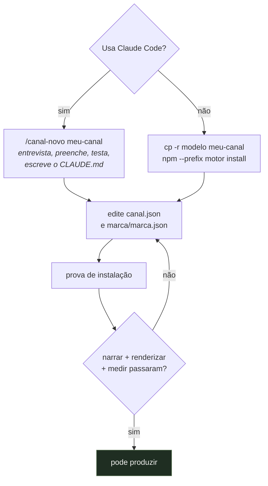
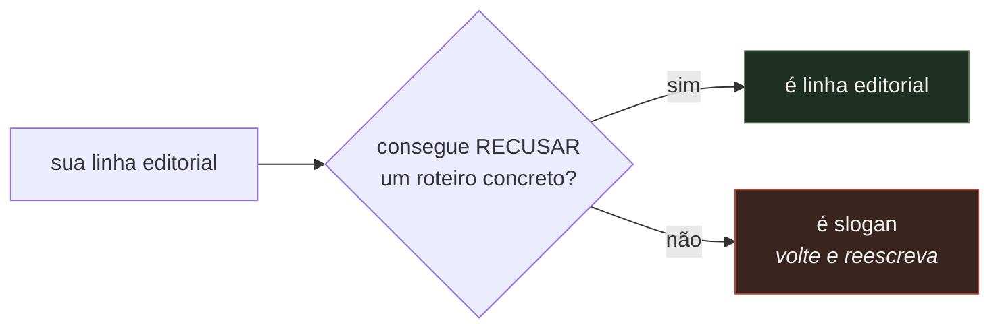
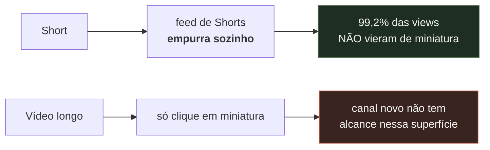
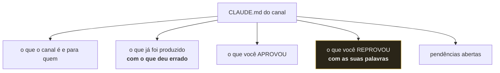

# Criar um canal

## Dois caminhos



---

## O que você edita, e o que não

| Arquivo | É de quem | Edita? |
| --- | --- | --- |
| `canal.json` | **do canal** — tema, linha, pilares, séries, cadência | ✏️ sim |
| `marca/marca.json` | **do canal** — cores, tipografia, voz | ✏️ sim |
| `plataformas/*.json` | **da plataforma** — medidas da interface, medidas em frame | 🔒 **não** |

Um canal novo não tem que remedir a coluna de ícones do Instagram para escolher
as próprias cores.

---

## A linha editorial precisa ser capaz de reprovar



**Teste:** escreva um exemplo de vídeo que ela recusaria. Não conseguiu? Volte.

Uma que funcionou: *"explicado pelo mecanismo, não pela torcida"* — ela reprova
na hora qualquer roteiro que torça por um lado em vez de mostrar como funciona.

---

## Pilares, séries e a armadilha do selo

- **Pilares** são tipos de conteúdo, não assuntos. 4 a 6, proporção somando 1.
- **Séries** dão reconhecimento.

> ⚠️ **Não ponha duração no nome do selo.** Um canal rodou meses com
> "Conceito em 40 s" em vídeos de **30 s**, porque o selo foi escrito antes de
> o tempo passar a sair do áudio medido.

---

## Cadência: comece só com vídeo curto

Isto é **dado**, não cautela. O mesmo título, no mesmo canal, com quatro dias
de diferença:

| | views | inscritos | |
| --- | ---: | ---: | --- |
| **Short, 33 s** | **1.110** | **7** | `████████████████████` |
| **Longo, 13 min** | **1** | 0 | `▏` |

**O mecanismo:**



Deixe `formatos.longo.ativo: false`. Ligue quando a conta já tiver público.

---

## Marca: duas regras que sobreviveram à prática

| Regra | Por quê |
| --- | --- |
| Fundo **quase** preto, não preto puro | preto puro achata o gráfico |
| Uma cor **só** para custo/perda | cor que aparece sempre deixa de ser lida |

Os nomes das cores são semânticos (`custo`, `ouro`, `texto`), nunca literais.
Um componente pede "custo", não "vermelho" — então trocar a paleta **não exige
reler componente nenhum**.

---

## Prove antes de produzir

```bash
python3 -I ferramentas/narrar.py conteudo/exemplo-tres-alugueis
./renderizar.sh conteudo/exemplo-tres-alugueis
python3 -I ferramentas/medir-reel.py conteudo/exemplo-tres-alugueis/out/reel.mp4
```

Sem chave, sem GPU, sem custo. Os três passando, a instalação está correta.

### Voz de verdade, quando quiser

```bash
export MODAL_TTS_URL=https://...modal.run   # chave no ambiente, NUNCA versionada
```

Publique `adaptadores/tts/modal-kokoro-ptbr/app.py` no Modal e troque
`adaptadores.tts` para `"kokoro"`. Custo medido: **< US$ 0,50** por semana de
9 vídeos.

---

## O `CLAUDE.md` do canal

É o diário, e é o que toda sessão futura da IA herda.



> **Registre as reprovações com mais cuidado que as aprovações.** São elas que
> impedem a IA de refazer o que você já recusou.

> ⚠️ **Numa automação, documento desatualizado não é registro errado: é
> instrução viva.** Uma regra que você revogou mas que continua escrita volta a
> ser seguida sem ninguém decidir isso de novo.
