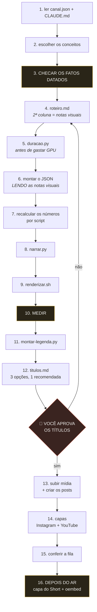
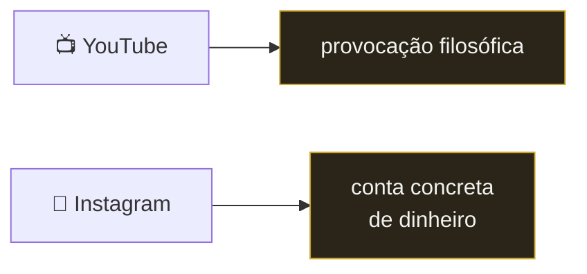
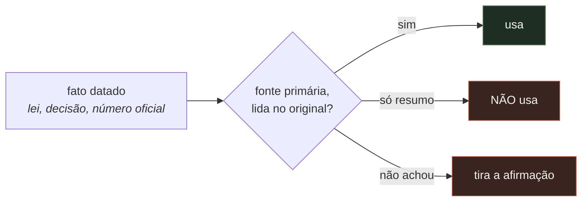

# Produzir uma semana

Com a IA: `/produzir semana`. Ela para nos títulos e espera o seu sim.

## O caminho inteiro, com a parada

**Não suba mídia nem crie post antes do sim.** É a única parada obrigatória.

---

## As duas plataformas querem coisas OPOSTAS

Mesmo acervo, mesmo canal:

| Vídeo | YouTube | Instagram |
| --- | ---: | ---: |
| provocação filosófica | **1.113** `████████████████` | 109 `██` |
| conta concreta de dinheiro | 7 `▏` | **439** `██████` |

Meça no seu canal antes de generalizar. Mas **não assuma que o que funciona num
lugar funciona no outro.**

---

## Título: duas regras vindas de dado

| Regra | Evidência |
| --- | --- |
| **Rótulo ideológico mata o alcance** | "libertarianismo explicado" → mediana **66** views · "economia explicada rápido" → **316 mil** |
| **Use o termo que as pessoas buscam** | "escala 6x1" → o assunto · "6x1" → placar de futebol |

3 opções em `titulos.md`, 1 recomendada. **Guarde o porquê da recomendação:**
quando você escolhe outra e o vídeo vai mal, o registro é o que permite
aprender.

---

## Checar os fatos ANTES de escrever

**Resumo de terceiro já contradisse a lei em três casos num só canal** —
inclusive uma página oficial desatualizada contra a própria lei que ela resume.

> ⚠️ **Gancho com data.** "Hoje a República faz 137 anos" num vídeo que vai ao
> ar quatro dias depois está errado, e consertar implica **narração nova e
> render novo**. Decida a data de publicação antes de escrever o gancho.

---

## O que dá e o que NÃO dá para corrigir depois

| | YouTube | Instagram |
| --- | :---: | :---: |
| título | ✅ | — *(não tem campo)* |
| descrição / legenda | ✅ | ❌ *(API não cobre)* |
| capa | ✅ *depois do ar* | ❌ *só à mão no app* |
| **áudio** | ❌ | ❌ |

Uma narração que afirmou algo sem ressalva **não se conserta**. A descrição dá
para editar; a fala não.

---

## Depois do ar, e nada dispara sozinho

| Passo | Confira onde |
| --- | --- |
| aplicar a capa do Short | URL **assinada** (`yt-dlp --dump-json`) |
| conferir o título | **oembed** |
| conferir a capa do Reel | **grade do perfil** |

Nunca pelo campo de analytics: ele serve um asset cacheado e **já indicou falha
numa correção que tinha funcionado**.

---

## Custo

**< US$ 0,50** por semana de 9 vídeos narrados.

O que custa caro é refazer. O que faz refazer é pular a medição.
