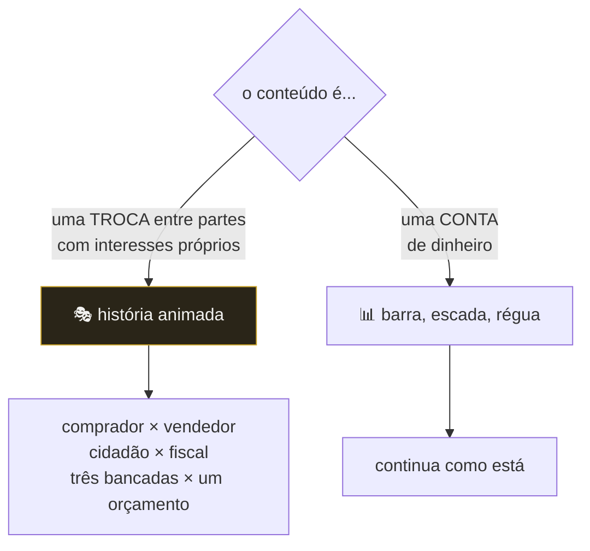
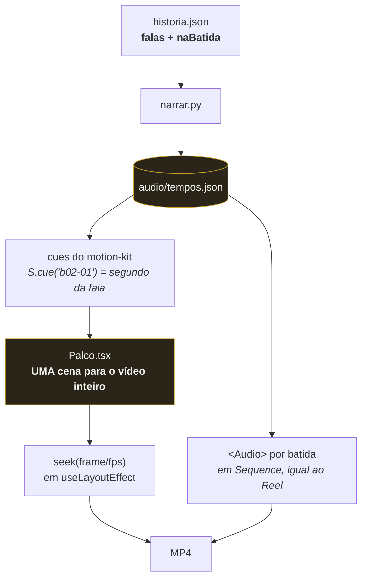
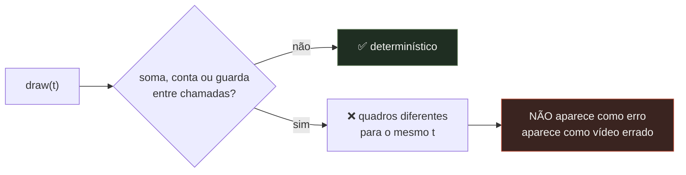
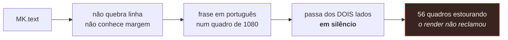

# Histórias animadas

Pessoas desenhadas por código, agindo no ritmo da voz. Usa o
[motion-kit](https://github.com/Gaok1/motion-kit), fixado no commit `459b0ee`.

## Quando usar



O que a história mostra e um gráfico não mostra: que são **pessoas**, agindo
uma de cada vez, por motivos delas.

---

## A arquitetura da ponte



### As três decisões, e o que cada uma evita

| Decisão | Se fosse o contrário |
| --- | --- |
| **Uma cena** para o vídeo inteiro | `MK.start` zera o estado global (o MK é **singleton**). Uma cena por bloco faria cada `<Sequence>` zerar as outras, e o render sairia **diferente conforme a ordem dos frames**. |
| Batidas viram **`cues`** | voltaria o número de frame escrito à mão |
| `seek` em **`useLayoutEffect`** | o Remotion tira o retrato depois do commit; `useEffect` roda **depois** dele, e o 1º quadro sairia atrasado |

O áudio continua por batida, em `<Sequence>`. **Os dois não se encontram** — é
isso que mantém a garantia central.

---

## Regra do `draw`: função pura do tempo



O Remotion visita os frames em **páginas paralelas**.

**Teste de sanidade:** compare capturas em `seek(3.2)` antes e depois de
`seek(7)`. Têm que ser idênticas.

> ✅ **Verificado neste framework:** 81 quadros byte a byte idênticos entre
> concorrência 6 e concorrência 1.

---

## A armadilha que já custou um render



O motion-kit foi escrito para 1280×720 com rótulos curtos em inglês.

**Use `frase()`**, de `src/historia/cenas.tsx`, que mede e quebra dentro da
régua. Nunca `MK.text` direto.

---

## Escrever

```json
{
  "formato": "9:16",
  "blocos": [{
    "tipo": "cena", "cena": "conversa",
    "dados": {
      "legenda": "Nenhum dos dois sabe o que o outro faz",
      "pessoas": [
        { "nome": "lenhador",   "naBatida": 0 },
        { "nome": "grafiteiro", "naBatida": 1, "olhaPara": "esquerda" }
      ]
    },
    "falas": [
      "Um corta a madeira no Oregon e nunca viu uma mina de grafite.",
      "O outro tira grafite no Ceilão e nunca serrou uma tábua."
    ]
  }]
}
```

`x` é **opcional**: sem ele as pessoas se distribuem sozinhas dentro da régua,
o que sobrevive à troca de formato melhor que número escolhido a olho.

| `"formato"` | Sai em | Régua |
| --- | --- | --- |
| `"9:16"` | 1080×1920 | interface do Reels |
| `"16:9"` | 1920×1080 | player do YouTube |

> ✅ **Verificado:** a mesma história com o campo trocado saiu em 1920×1080 e
> passou o `medir-longo.py` com zero estouro nas quatro faixas.

---

## O catálogo, e o que ele NÃO faz

| Cena | O quê |
| --- | --- |
| `titulo` | frases que entram uma por batida, sem personagem |
| `conversa` | pessoas numa linha de chão, cada uma na sua batida |

Duas, de propósito: **ponto de partida, não acervo.** Cena nova em
`motor/src/historia/cenas.tsx`. Receitas em
`motor/vendor/motion-kit/docs/recipes.md`, já em português.

| ❌ Não tem | Esclarecimento |
| --- | --- |
| sincronia labial | a boca se move **na janela da fala**. O motion-kit não trabalha com fonema — chamar de lip-sync seria mentira. |
| esqueleto / sprite | as pessoas são desenhadas por código; a pose é um conjunto de ângulos |
| áudio | está fora do escopo do projeto e nunca vai ter. A voz vem do framework. |
| muito movimento, ainda | as figuras entram e ficam de pé. Caminhada, gesto e câmera existem na biblioteca e **ainda não foram trazidos para o catálogo**. |
