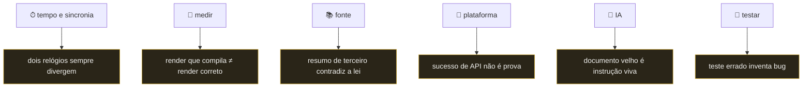
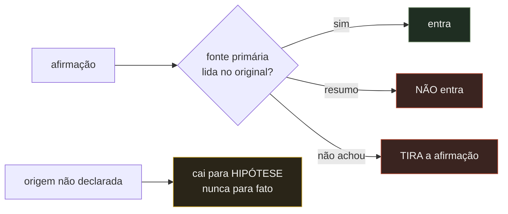

# O que aprendemos errando

Cada linha aqui custou tempo, dinheiro ou um vídeo errado no ar.

## Mapa: onde o erro entra

---

## ⏱ Tempo e sincronia

| Lição | O que aconteceu | Número |
| --- | --- | --- |
| **Dois relógios sempre divergem** | duração digitada à mão + voz colada depois | **76,6 s** de tela parada, **18%** da semana |
| **Comentário que avisa não conserta** | o código dizia *"quando a voz for gravada, troque este cálculo"* | nunca foi trocado — funcionava o suficiente para ninguém olhar |
| **Taxa única não serve para dois formatos** | "palavras por minuto" mistura ritmo de fala com silêncio de borda fixo | erro de **14%** → **0,8%** com dois termos |

---

## 📏 Medir

| Lição | O que aconteceu |
| --- | --- |
| **Render que compila não é render correto** | todo defeito de layout foi achado por medição; vários passaram por revisão humana antes |
| **A régua errada produz relatório FALSO** | relatei 33 px de estouro medindo a faixa do meio contra a régua da faixa de baixo |
| **3 quadros/s não bastam** | um carimbo entrava com zoom e passava do limite por poucos quadros; só apareceu depois que uma narração nova mudou o tempo |
| **O medidor mede margem, não verdade** | uma capa dizia "Durou quatro meses" sem fonte, e passou em todas as medições |
| **Não afrouxe o limiar** | quando o texto encostou na linha da margem, a saída foi recuar o texto — baixar o limiar cegaria a verificação |

---

## 📚 Fonte

**Três casos num só canal:** uma página oficial de "Regras" desatualizada
contra a própria lei que resume; um resumo atribuindo a um artigo um prazo que
ele não fixa; uma fonte dizendo "TR" onde a lei diz outra coisa.

> **O silêncio tem que cair para o lado fraco.** Se esquecer de declarar a
> origem significar "é fato", o esquecimento vira afirmação.

---

## 🔌 Plataforma

| Sintoma | Causa real |
| --- | --- |
| "Os Reels sobem com capa preta — bug de upload?" | **não.** `thumbOffset` tem padrão **0**, e o quadro 0 é o fundo ainda vazio |
| "O título do vídeo saiu errado" | o campo certo é `platformSpecificData.title`, não o `title` da raiz |
| "A capa do Short não trocou" | trocou. A URL `oar2.jpg` é **cacheada pelo CDN**, com byte count idêntico |
| "O analytics diz que a capa falhou" | o campo é um **asset cacheado**; a correção tinha funcionado |

**Mensagem de sucesso da API não é prova. Confira onde o público vê:**

| O quê | Onde conferir |
| --- | --- |
| capa de Instagram | grade do perfil |
| título de YouTube | oembed |
| capa de Short | URL **assinada** |

---

## 🤖 Trabalhar com IA

| Lição | Consequência prática |
| --- | --- |
| **Documento desatualizado é instrução viva** | regra revogada que continua escrita volta a ser seguida **sem ninguém decidir isso de novo** |
| **Edite o arquivo que a automação LÊ** | num canal, uma correção entrou no espelho versionado e ficou fora do arquivo ao vivo por uma semana |
| **Registre as REPROVAÇÕES** | "o Condorcet de pizza foi reprovado por abstrato demais" vale mais que dez elogios |
| **Nunca reescreva histórico numa pasta que outra sessão edita** | um `git lfs migrate --everything --yes` avisou que o working copy seria sobrescrito e levou edições não commitadas de sessões irmãs |

---

## 🧪 Testar

| Erro de teste | O que ele faria com você |
| --- | --- |
| Teste que passa com **as duas pastas vazias** | deu "idênticos" comparando o hash do conjunto vazio consigo mesmo. **Conte os artefatos antes de comparar hashes.** |
| Comparar o **vídeo codificado** | 359 quadros "diferentes" entre concorrência 6 e 1. Não era o render: **h264 não é byte-determinístico**. Em PNG: 81 quadros idênticos. |

O teste errado manda alguém caçar um bug que não existe.

---

## 📊 O que o dado disse e o gosto não diria

| Achado | Números |
| --- | --- |
| **Rótulo ideológico mata o alcance** | 66 views `▏` · 316 mil `████████████████████` |
| **As plataformas querem coisas opostas** | filosofia: YT **1.113** / IG 109 · dinheiro: YT 7 / IG **439** |
| **Longo precisa de público que canal novo não tem** | mesmo título, 4 dias: Short **1.110** views e **7** inscritos · longo **1** view, **0** |

> ⚠️ **Mas o dado não separa tudo.** Onde o longo teve miniatura servida, quem
> clicou viu **1:17 de 12:59**. Então não era só distribuição: título, capa e
> os primeiros minutos também precisavam de trabalho.
>
> Escrever que era "só distribuição" mandaria uma sessão futura pular
> justamente o que faltava.
