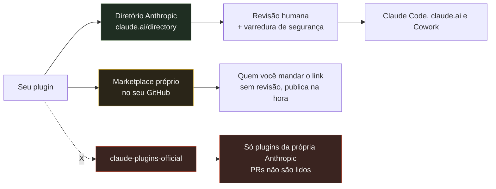
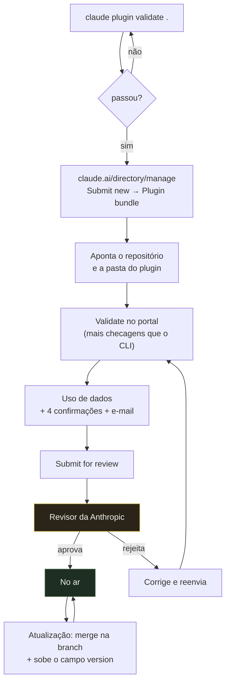
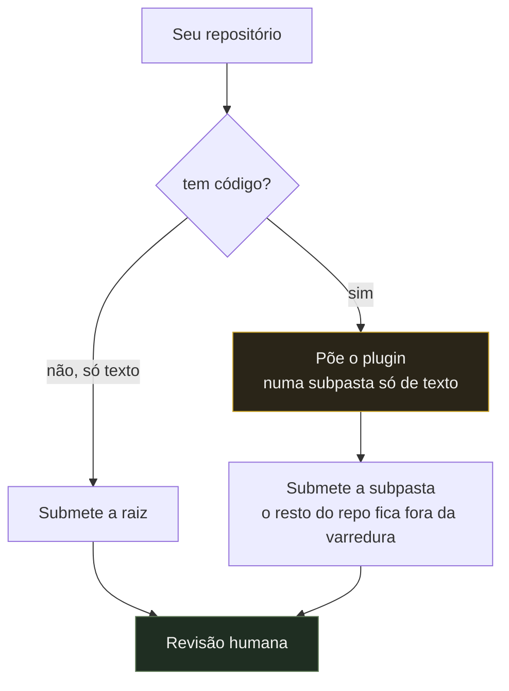

# Publicar no diretório da Anthropic

Levantado em 20/11/2026, nas docs oficiais. **O processo muda: confira antes de
submeter.**

## Onde dá e onde não dá



| | Diretório | Marketplace próprio | `claude-plugins-official` |
| --- | --- | --- | --- |
| Aceita você? | **sim** | sim | **não** |
| Revisão | humana, prazo não divulgado | nenhuma | só por contato de parceiro |
| Alcance | Claude Code + claude.ai + Cowork | quem tem o link | todo mundo |
| Custo | zero (mas exige plano pago) | zero | — |
| Hoje o motor está | não submetido | **funcionando** | — |

> *"Pull requests to this repository are not monitored."* — README do
> `claude-plugins-official`

## O caminho da submissão



**Pré-requisitos:** plano pago (Free não submete), conta GitHub conectada,
repositório **público para publicar** (pode ser privado só para validar).
Limite de 10 submissões por 24 h.

## O CLI não vê o que o portal vê

Isto foi medido em 20/11/2026, submetendo de verdade. **`claude plugin validate
.` passa limpo com zero achados, e o portal recusa.** Eles não rodam as mesmas
regras.

A regra que decide tudo: **de organização não Verificada, o Diretório aceita
só texto.** Markdown, texto, JSON, YAML e imagem PNG, JPEG, GIF, WebP ou ICO.
Nada que comece com `#!`. Nenhum `.py`, `.ts`, `.tsx`, `.sh`, `.js`, `.css`.
E `package.json` só com os campos de uma lista curta, que **não inclui
`scripts` nem `dependencies`**.

> *"Anthropic chooses who is a Verified organization, and there's no way to ask
> to become one yet."* — o próprio portal



**O validador mostra um achado por verificação, não a lista.** Ele nomeou
`.githooks/pre-push`; corrigido, nomeou `modelo/adaptadores/publicacao/manual.py`;
no campo, nomeou `scripts` e depois `dependencies`. Corrigir um por um não
converge: se o seu repositório tem código, a resposta é a subpasta, e o portal
diz isso na própria mensagem.

| Achado do portal | Código | O que significa |
| --- | --- | --- |
| arquivo fora da lista | `LOCAL_CODE_FILE_TYPE` | bloqueia. Só texto e imagem |
| campo fora da lista | — | bloqueia. `package.json` enxuto |
| baixa e executa | `RUNTIME_FETCH_EXEC` | avisa. Vale **até em documentação** |
| usa credencial da máquina | — | retém. Some quando o arquivo que a lê sai |

O `RUNTIME_FETCH_EXEC` pegou `.apt_install("ffmpeg")` num app do Modal e
`npx playwright install chromium` no README de uma biblioteca **vendorizada**.
Não precisa ser comando seu, nem precisa rodar: basta estar escrito.

## Como o motor-de-canal ficou

```
motor-de-canal/
├── plugin/              ← isto é o que vai ao Diretório
│   ├── .claude-plugin/  plugin.json + icon.png
│   ├── skills/          9 skills, Markdown
│   ├── commands/        4 comandos, Markdown
│   └── README.md, LICENSE
├── modelo/              ← o motor. Fica no GitHub
├── docs/
└── .claude-plugin/marketplace.json   source: "./plugin"
```

| Caminho | O usuário recebe |
| --- | --- |
| Diretório Anthropic | doutrina e comandos. `/canal-novo` clona o motor |
| marketplace do repositório | tudo, motor incluído, sem revisão |

O `/canal-novo` procura o motor em três lugares, nesta ordem:
`${CLAUDE_PLUGIN_ROOT}/../modelo`, uma cópia que o usuário já tenha, e por fim
um `git clone --depth 1` do repositório.

| Requisito do CLI | Estado |
| --- | --- |
| `name` minúsculo, sem reservados | ✅ `motor-de-canal` |
| `LICENSE` + `license` no plugin.json | ✅ MIT nos dois |
| README ≥ 40 palavras | ✅ |
| Ícone PNG quadrado 512–2048 px | ✅ 1024×1024 |
| Sem symlink, submódulo, LFS | ✅ |
| Repo < 50 MiB, < 10.000 arquivos | ✅ |
| Sem credencial embutida | ✅ chave só em variável de ambiente |
| Repositório público | ✅ |

## Três armadilhas

**O ícone é tiro único.** Ele vira o ícone do listing **uma vez**, na primeira
vez que o plugin é salvo ou submetido no portal. Trocar depois não muda nada.

**O nome é permanente.** *"Never change a published plugin's name."*

**Sem subir `version`, ninguém recebe a atualização.** O merge é pego sozinho,
mas o campo precisa crescer.

## O que ainda não foi conferido

A [Software Directory Policy](https://support.claude.com/en/articles/13145358-anthropic-software-directory-policy)
e os [Terms](https://support.claude.com/en/articles/13145338-anthropic-software-directory-terms)
não foram lidos. Nenhuma página de documentação exige idioma, então um plugin
em português não é proibido pelo que foi lido — mas é na Policy que uma regra
dessas estaria.

**Prazo de revisão:** não divulgado. *"Review time isn't fixed."*

## Fontes

- [Submit your plugin](https://claude.com/docs/plugins/submit)
- [Publish and distribute a plugin](https://code.claude.com/docs/en/plugins/publish)
- [Pre-submission checklist](https://claude.com/docs/plugins/pre-submission-checklist.md)
- [claude-plugins-official](https://github.com/anthropics/claude-plugins-official)
