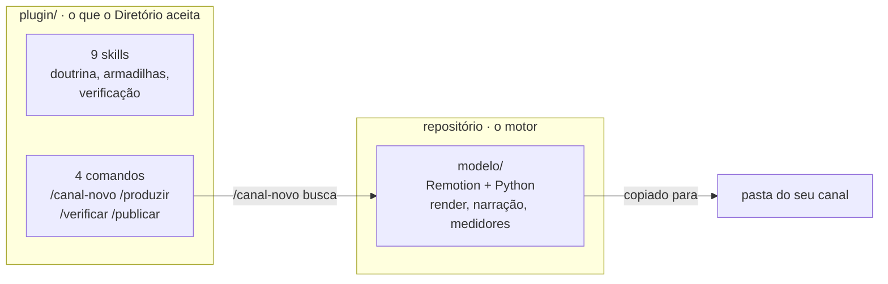

# Motor de Canal — plugin

Doutrina e comandos para criar e operar um canal de vídeo curto automático.
Extraído de um canal em operação, não de teoria.

## O que está aqui e o que não está



O Diretório Anthropic aceita, de organização não Verificada, **só texto**:
Markdown, JSON, YAML e imagem. O motor é Python, TypeScript e shell, então ele
fica no repositório, a um `git clone` de distância, e `/canal-novo` vai buscar.

| Você quer | Instale |
| --- | --- |
| só a doutrina, para aplicar no seu próprio sistema | este plugin |
| o sistema inteiro, render incluído | o marketplace do repositório (abaixo) |

```bash
# plugin + motor, numa tacada
/plugin marketplace add claudiogpt/motor-de-canal
```

Depois, `/canal-novo <pasta>`.

## As nove skills

| Skill | O que resolve |
| --- | --- |
| `motor-de-canal` | índice: qual das outras usar |
| `arquitetura-de-tempo` | o áudio manda no tempo, e por que não existe mux |
| `doutrina-editorial` | mecanismo em vez de torcida, steelman, fonte para todo número |
| `verificacao-por-medicao` | medir em frame, não olhar; o medidor não mede verdade |
| `armadilhas-de-plataforma` | capa preta, título que não é título, régua por altura |
| `historia-animada` | personagens e cena animada com motion-kit |
| `canal-novo` | a entrevista de seis perguntas |
| `producao-semanal` | a rodada de produção, do conceito ao agendamento |
| `documentacao-visual` | documentação para humanos é gráfico primeiro |

## O que sai da sua máquina

O plugin em si é texto: skills e comandos. Ele não lê dado pessoal, não guarda
nada e não tem serviço do outro lado. Mas dois **passos que ele instrui** falam
com serviço de terceiro, e quem roda é você, com as suas chaves:

| Passo | Para onde vai | O que vai |
| --- | --- | --- |
| narração (`/produzir`) | o **seu** endpoint de TTS, se você configurar um (`MODAL_TTS_URL`) | o texto das falas do vídeo |
| publicação (`/publicar`) | a **sua** API de publicação e, por ela, Instagram e YouTube | o vídeo, a capa e a legenda |

Nenhum dos dois é obrigatório. O adaptador padrão de voz (`estimativa`) roda
local, sem chave e sem rede, e o de publicação (`manual`) só prepara a pasta.
Nenhuma chave vem com o plugin: elas ficam no `.env` do seu canal.

## Repositório, documentação e licença

Código, motor e os seis guias: <https://github.com/claudiogpt/motor-de-canal>

[MIT](LICENSE).
